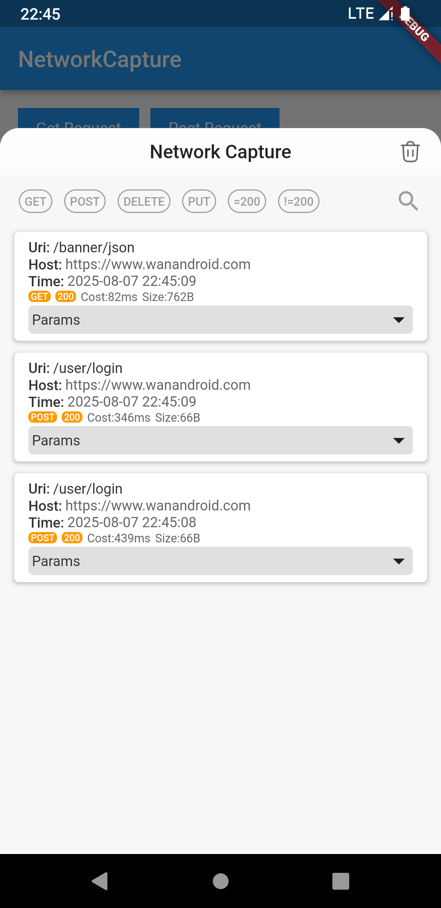
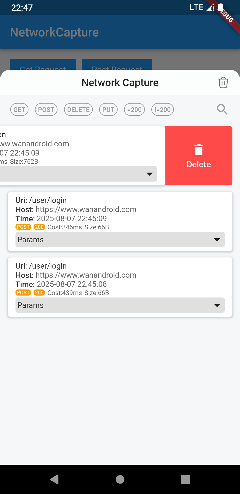
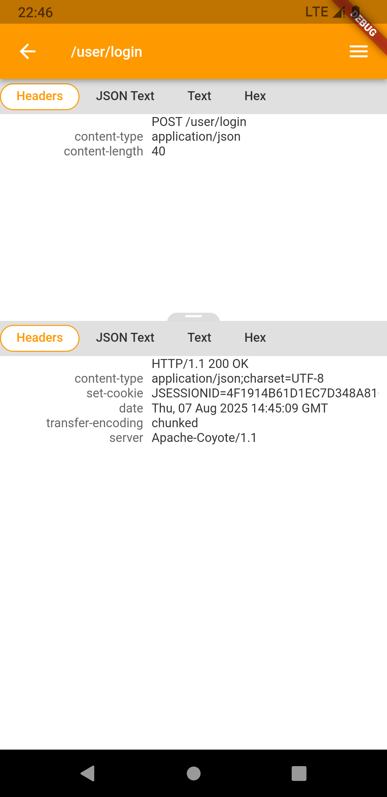
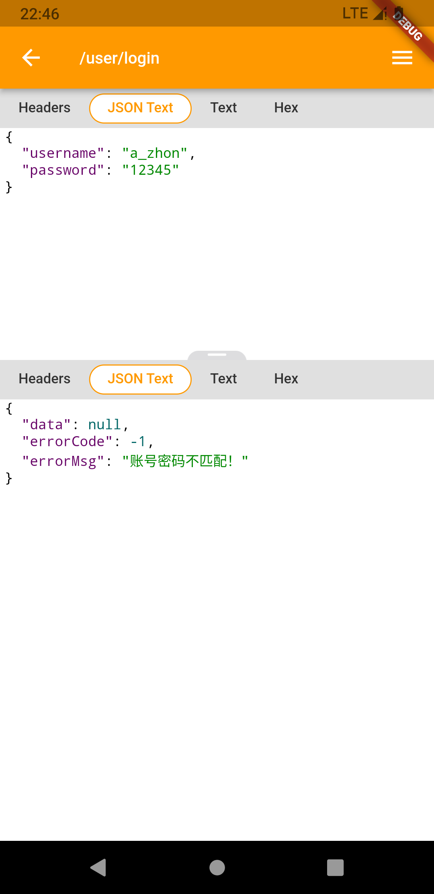
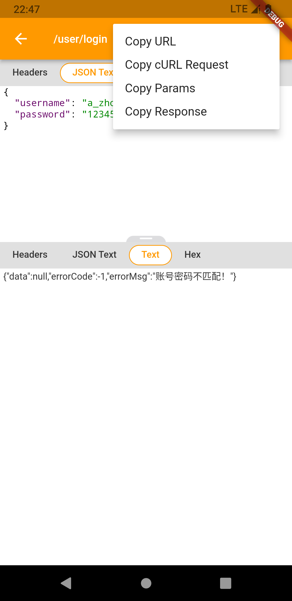
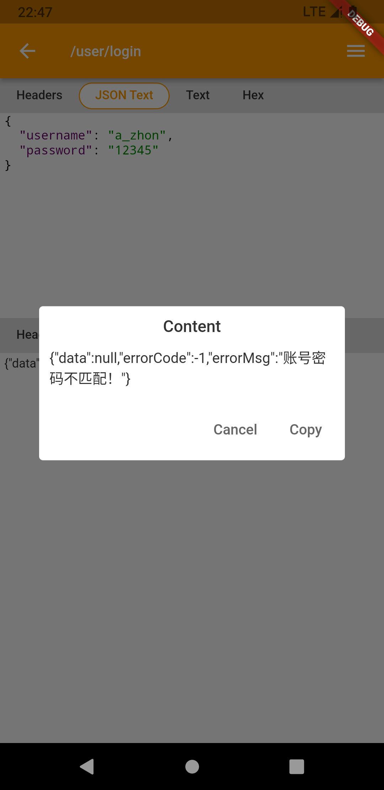

# Flutter Network Capture

`network_capture` 是一个用于 Flutter 开发和测试阶段的网络调试插件。它通过 Dio 拦截器记录 HTTP(S) 请求，并提供应用内浮动入口查看抓包记录。

> [!WARNING]
> 仅在可信的调试环境中启用。请求头、请求参数、响应头和响应内容会写入本地 SQLite 数据库，当前不会对令牌、密码或个人信息做脱敏。不要在发布版本中启用，也不要将真实敏感数据留在调试记录中。

## 功能

- 查看 Dio 请求的成功响应和错误记录，包括方法、URL、状态码和耗时。
- 搜索 URL 或参数，并按请求方法或状态码筛选。
- 查看请求和响应的 headers、query 参数及文本、JSON、十六进制等内容视图；支持的表单请求会显示 multipart 信息。
- 复制 URL、cURL 请求、请求参数或响应内容；删除单条记录或清空记录列表。
- 记录保存于本机 SQLite 数据库，不会由本插件上传。

## 支持平台

插件声明支持 Android、iOS、Windows、macOS 和 Linux。桌面平台使用 SQLite FFI；具体构建与运行能力仍受 Flutter、SQLite 依赖和目标平台配置影响。

## 安装与接入

在 `pubspec.yaml` 中添加依赖：

```yaml
dependencies:
  network_capture: ^1.2.3
```

将应用入口包在 `NetworkCaptureApp` 中，并把同一个 `navigatorKey` 传给内部的 `MaterialApp`。只有 `enable: true` 时才会显示可拖动的抓包入口。

```dart
import 'package:flutter/material.dart';
import 'package:network_capture/network_capture.dart';

final navigatorKey = GlobalKey<NavigatorState>();

void main() {
  runApp(
    NetworkCaptureApp(
      enable: true, // 仅在调试配置中启用
      navigatorKey: navigatorKey,
      child: MaterialApp(
        navigatorKey: navigatorKey,
        home: const MyHomePage(),
      ),
    ),
  );
}
```

为使用的 Dio 实例添加 `CaptureDioInterceptor`：

```dart
import 'package:dio/dio.dart';
import 'package:network_capture/network_capture.dart';

final dio = Dio()..interceptors.add(CaptureDioInterceptor());
```

拦截器只记录经过该 Dio 实例的请求。使用其他 HTTP 客户端或未添加拦截器的 Dio 实例时，请求不会出现在列表中。可运行 [`example/`](example/) 查看完整示例。

## 使用抓包界面

启动后点击浮动入口打开记录列表。可以拖动入口；列表支持按 GET、POST、DELETE、PUT、状态码为 200 或不为 200 筛选，也可搜索 URL 和参数。点选记录可查看请求和响应详情，并通过菜单复制 URL、cURL、参数或响应。列表顶部的清除按钮会清空所有记录。

## 本地开发

在仓库根目录执行：

```sh
flutter pub get
flutter test
flutter analyze
```

运行示例应用：

```sh
cd example
flutter run
```

截图：

 
 
 
